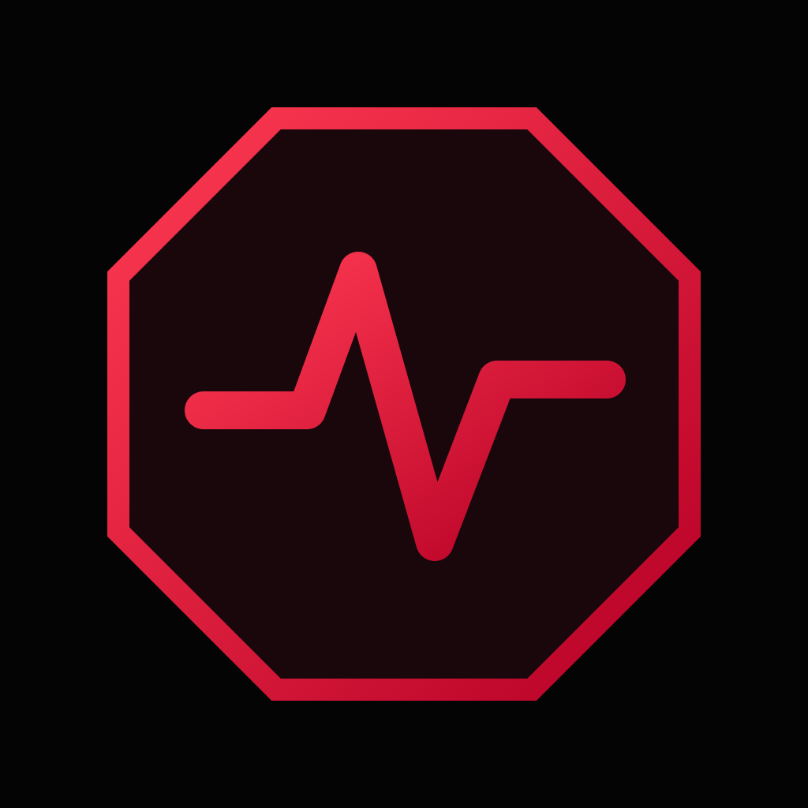
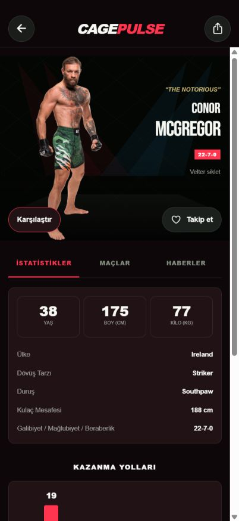
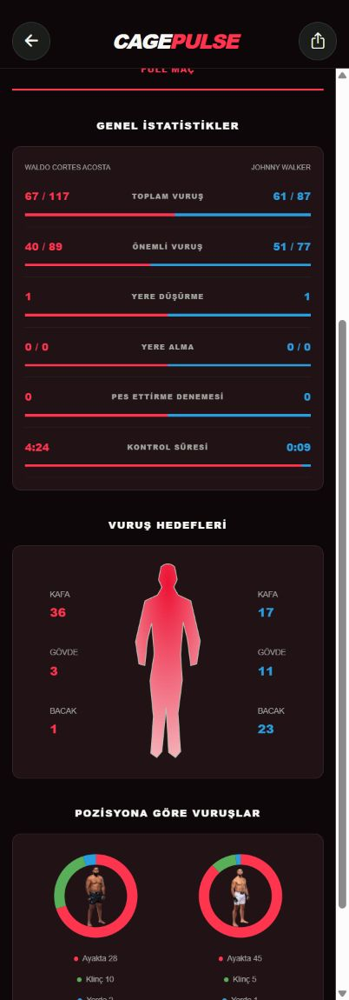
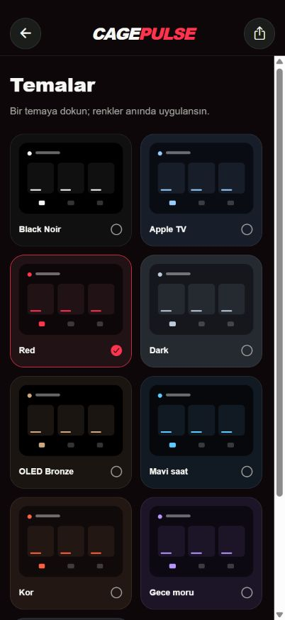

<h1 align="center">CagePulse</h1>

MMA events, fighters and fight statistics.

<a href="README.md">Türkçe</a> · <b>English</b>

## Download

| Platform | Latest package | Requirements |
| --- | --- | --- |
| Android | [Download APK](https://github.com/Berkayrealx/cagepulse-releases/releases/latest/download/CagePulse-Android-arm64.apk) | Android 8.0+ · ARM64 |
| iPhone / iPad | [Download IPA](https://github.com/Berkayrealx/cagepulse-releases/releases/latest/download/CagePulse-iPhone-iPad.ipa) | iOS 15.1+ · sign with your own Apple account |

[Latest release details](https://github.com/Berkayrealx/cagepulse-releases/releases/latest)

This repository contains app downloads, screenshots and documentation only. Application source code, API credentials, account information and private signing files are not published here.

## Screenshots

| Fighter profile | Fight statistics | Mavio theme gallery |
| :---: | :---: | :---: |
|  |  |  |

These images show the actual app’s web preview at phone dimensions. Native iPhone Liquid Glass is not rendered in browser screenshots. The Android app uses standard black/red controls.

## Features

- UFC/MMA event schedule with main-card and preliminary sections.
- Fighter search, following, physical comparisons, win methods and career statistics.
- Past fights with available winners, finish methods, rounds and times.
- Full-fight strike, takedown, control-time, target and position statistics.
- Time-based main-card, preliminary-card and custom-time reminders.
- Turkish by default; English and Brazilian Portuguese interface options.
- iPhone/iPad: interactive native Liquid Glass on supported iOS 26+ devices, plus nine Mavio themes.
- Android: standard black/red styling and a flat bottom navigation bar, without glass effects.
- Saved news, read filters, personal notes and a local cache.

## Installation

**Android**

Download the APK and open it on your device. If Android prompts, allow installation for the browser or file manager you are using. A previous CagePulse installation can be updated using the new package signed with the same key; avoid uninstalling first if you want to keep local data.

**iPhone / iPad**

Download the IPA to your computer, select it in your existing iOS signing/installation tool, then sign and install it with your own Apple account. Complete the developer trust and Developer Mode steps if iOS requests them.

The IPA is an unsigned device build, not an App Store or TestFlight release. Simply opening it on an iPhone does not install it. Never post Apple passwords, verification codes or tokens in GitHub issues.

## Getting started

1. Open an upcoming or past card in **Events**.
2. Tap a fight for details. Use **Show results** when spoiler protection is enabled; change the default in Settings.
3. Find a fighter by name or division. The **Fights** tab includes past bouts and an **Older fights** button.
4. Select your language in **Settings**. iPhone users can open the separate **Themes** gallery.
5. Open a future event’s reminder controls to schedule a notification. Notification permission is required.

## Data and current limits

Schedules and statistics come from ESPN; news comes from free RSS sources. Provider delays, missing fields and card changes are possible. When the source combines KO and TKO, the app displays **KO/TKO**. Missing measurements or statistics are not invented.

- This version shows full-fight totals; detailed per-round statistics and official scorecards are not included.
- Links to Fight Digitale, MMA101Türkiye and ChampRDS are available. An automatic X post feed is not connected, and no X token is required.
- Notifications triggered by the previous fight ending are not implemented yet. Current reminders are time-based.
- Community services, account synchronization and server push are not enabled in this distribution.
- Silent mode and Focus settings may suppress ordinary notification sounds.

CagePulse is not officially affiliated with UFC, ESPN or MMA360. News headlines, images and content belong to their respective publishers.

## Support

- [Report a problem on GitHub](https://github.com/Berkayrealx/cagepulse-releases/issues)
- Telegram: [@berkayrealx](https://t.me/berkayrealx)
- Discord: **@berkayrealx**

Include the app version, device, operating system and reproduction steps. Hide personal information in screenshots.

> GitHub’s automatically generated “Source code” archives contain this documentation repository and its images only, not the application source code.
