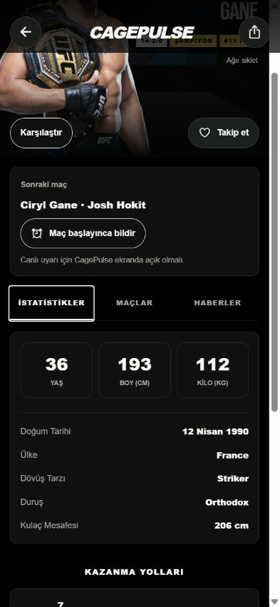
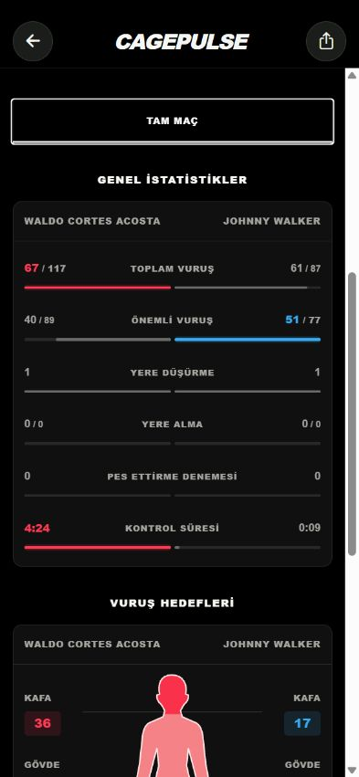
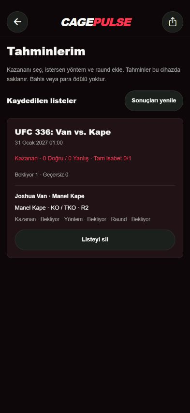
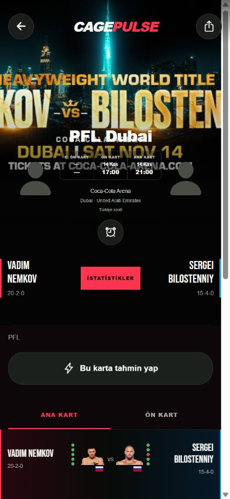
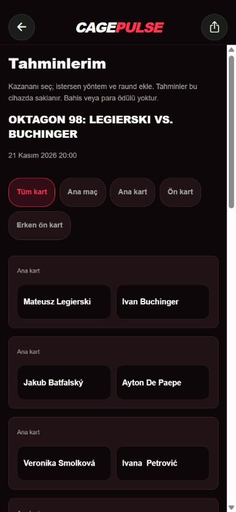

<h1 align="center">CagePulse</h1>

MMA events, fighters and fight statistics.

<a href="README.md">Türkçe</a> · <b>English</b>

## Download

| Platform | Latest package | Requirements |
| --- | --- | --- |
| Android | [Download APK](https://github.com/Berkayrealx/cagepulse-releases/releases/latest/download/CagePulse-Android-arm64.apk) | Android 8.0+ · ARM64 |
| iPhone / iPad | [Download IPA](https://github.com/Berkayrealx/cagepulse-releases/releases/latest/download/CagePulse-iPhone-iPad.ipa) | iOS 15.1+ · sign with your own Apple account |

[Latest release details](https://github.com/Berkayrealx/cagepulse-releases/releases/latest)

This repository contains app downloads, screenshots and documentation only. Application source code, API credentials, account information and private signing files are not published here.

## Screenshots

| Fighter profile | Fight statistics |
| :---: | :---: |
|  |  |

These images show version 0.2.10 at phone dimensions in a web preview. Native iPhone Liquid Glass is not rendered in browser screenshots. The Android app uses standard black/red controls.

## Features

- **UFC, PFL and OKTAGON** events. Use **Events → All / UFC / PFL / OKTAGON** to switch organizations, then browse upcoming or past cards.
- Announced events approximately three years ahead. Refreshes on launch, return to foreground and every five minutes while active, with the last complete refresh time displayed.
- Saved event prediction cards: choose one fight or any subset of the card, with optional KO/TKO, submission, decision and round selections. Winner, method and round are graded separately.
- **Matchup watch**, available from News and Profile, shows sourced two-fighter matchup stories with publication dates. The app does not generate matchup probability percentages.
- UFC/MMA schedule, promotional event artwork, and separate early-prelim / prelim / main-card start times. Missing times are not guessed.
- Tap a fighter image or name on a card to open their profile; retain scroll position and section selection when going back.
- Sliding page transitions, iOS edge-back gesture, animated tab indicators and reduced-motion support.
- Official META/media rankings, a division selector sheet, P4P, card/list layouts and A–Z fighter search.
- Fighter following, physical comparisons and career statistics. Profiles include champion, P4P and divisional ranking badges plus published date and place of birth, UFC debut and leg reach.
- Source-available career history for ESPN-supported fighters, with winners, finish methods, rounds and times. OKTAGON profiles show the subset published on the official profile and saved event cards, without claiming a full career.
- Full-fight and round-by-round strikes, takedowns, control time, targets and position splits. The leading side is highlighted in its corner color. Rounds that did not take place are disabled.
- A lit cage backdrop, fighter-specific P4P and division badges, and published official judge scorecards.
- Odds published on UFC event pages, displayed as decimal prices. The lower-priced side is highlighted as the favorite.
- Current recent form is shown as up to five green/red dots. Gray indicates an unknown outcome. A plus sign means the displayed streak is a lower bound.
- Time-based main-card, preliminary-card and custom-time reminders.
- Live start alerts for a fighter’s next bout or a single matchup. CagePulse must be open on screen.
- Grouped settings with separate language and notification pages and in-app support links. Turkish, English and Brazilian Portuguese interface options.
- iPhone/iPad: native UIKit Liquid Glass buttons and system tab navigation on supported iOS 26+ devices, plus nine themes.
- Android: standard black/red styling and a flat bottom navigation bar, without glass effects.
- Disk/memory image caching, 64 bundled headshots, 65 proportional full-body portraits and four event artworks.
- Image-led news cards, fixed search and read filters, saved stories, and personal notes.
- Public posts from Fight Digitale and MMA 101 Türkiye on X, with source images and in-app video when available.

## Saved predictions and matchup watch

Open an event and tap **Predict this card**. Select winners, optionally add methods/rounds, then save. Return through **Profile → My predictions** to check your cards and results. Cards stay on this device and lock at event start. Confirmed cancellations/replacements are void; incomplete results remain pending. Cross-device prediction sync is not available in this version.

This is a phone-size web preview of version 0.2.11 with a sample selection created during verification.

| PFL fight card | OKTAGON predictions |
| :---: | :---: |
|  |  |

These two images show version 0.2.12 in a phone-size web preview, not physical-device or native Liquid Glass verification.

The schedule checks roughly three years ahead but can display only events already announced by the provider. Refresh runs while the app is active, not continuously when it is closed. Cached events survive connection failures. Matchup watch uses matching stories from the past 14 days; rumours are not confirmed matchups and no percentage is invented.

## Installation

**Android**

Download the APK and open it on your device. If Android prompts, allow installation for the browser or file manager you are using. A previous CagePulse installation can be updated using the new package signed with the same key; avoid uninstalling first if you want to keep local data.

**iPhone / iPad**

Download the IPA to your computer, select it in your existing iOS signing/installation tool, then sign and install it with your own Apple account. Complete the developer trust and Developer Mode steps if iOS requests them.

The IPA is an unsigned device build, not an App Store or TestFlight release. Simply opening it on an iPhone does not install it. Never post Apple passwords, verification codes or tokens in GitHub issues.

## Getting started

1. Select **All, UFC, PFL or OKTAGON** in **Events**, then open an upcoming or past card.
2. Tap a fighter name or image to open their profile; tap the surrounding row for fight details. Past fights display winners, finish methods, rounds and times directly.
3. Find a fighter by name or division. The **Fights** tab loads the history supplied by its source. Results are always visible here, and loaded fights are cached on the device.
4. Select your language in **Settings**. iPhone users can open the separate **Themes** gallery.
5. Open a fighter profile and select **Next fight → Notify when the fight starts**. You can also select **Single fight** in an event’s reminder controls. Notification permission is required.

## Data and current limits

- PFL uses ESPN plus [official PFL event pages](https://pflmma.com/events). OKTAGON reads the [official OKTAGON calendar and cards](https://oktagonmma.com/en/events/). Opening a card requests updated information; failures preserve saved data. Missing matchups or section start times are not invented. Some regional PFL events currently provide only dates, times and artwork through this version's source.
- PFL/OKTAGON bouts do not borrow UFC round statistics or odds. Published OKTAGON profile history can be limited. Live per-fight alerts support ESPN UFC/PFL cards while the app is open on screen; OKTAGON live start alerts and lock-screen push are not enabled.
Rankings come from the [official UFC rankings page](https://www.ufc.com/rankings); UFC supplies event artwork, card times, fighter biographies and detailed round statistics; ESPN supplies the schedule and fallback totals, and news comes from public X profiles, ESPN and RSS sources. META and media lists are kept separate; P4P is labeled as the media panel. The ranking screen displays the last-check timestamp. Provider delays, missing fields and card changes are possible. When the source combines KO and TKO, the app displays **KO/TKO**. Missing measurements or statistics are not invented.

- Round tabs and official scorecards work for bouts matched to UFC data. Available fight totals are shown when detailed data is unavailable. Odds only appear when the source publishes them. Prices are checked once a minute while an upcoming event is open.
- Fight Digitale and MMA 101 Türkiye posts are read from their public X profiles. If access or page structure changes, the last successful posts remain available. The source row opens the X profile, and the post button opens the original post.
- Live start alerts check the selected matchup’s ESPN status every 20 seconds while the app is open on screen. Provider delays may delay the alert. Live alerts on the lock screen require server push setup.
- Community services, account synchronization and server push are not enabled in this distribution.
- Silent mode and Focus settings may suppress ordinary notification sounds.

CagePulse is not officially affiliated with UFC, ESPN or MMA360. News headlines, images and content belong to their respective publishers.

## Support

- [Report a problem on GitHub](https://github.com/Berkayrealx/cagepulse-releases/issues)
- Telegram: [@berkayrealx](https://t.me/berkayrealx)
- Discord: **@berkayrealx**

Include the app version, device, operating system and reproduction steps. Hide personal information in screenshots.

> GitHub’s automatically generated “Source code” archives contain this documentation repository and its images only, not the application source code.
