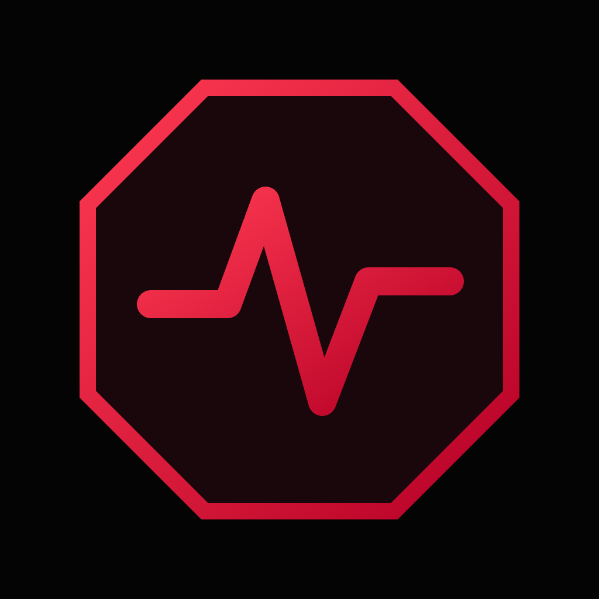
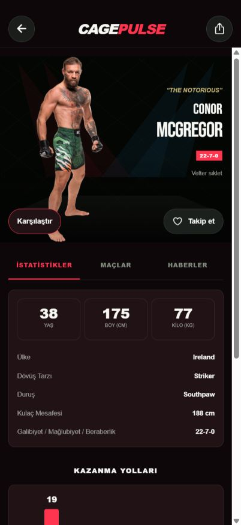
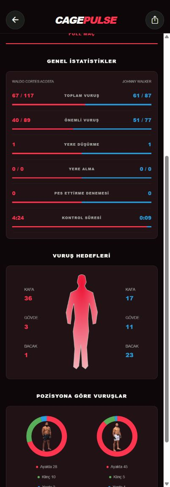

<h1 align="center">CagePulse</h1>

MMA takvimi, dövüşçüler ve maç istatistikleri.

<b>Türkçe</b> · <a href="README.en.md">English</a>

## İndir

| Platform | Güncel paket | Gereksinim |
| --- | --- | --- |
| Android | [APK indir](https://github.com/Berkayrealx/cagepulse-releases/releases/latest/download/CagePulse-Android-arm64.apk) | Android 8.0+ · ARM64 |
| iPhone / iPad | [IPA indir](https://github.com/Berkayrealx/cagepulse-releases/releases/latest/download/CagePulse-iPhone-iPad.ipa) | iOS 15.1+ · kendi hesabınla imzalama gerekir |

[Tüm sürüm bilgileri ve indirmeler](https://github.com/Berkayrealx/cagepulse-releases/releases/latest)

Bu depo yalnızca uygulama paketleri, görseller ve kullanım belgeleri içindir. Uygulamanın kaynak kodu, API anahtarları, hesap bilgileri ve özel imzalama dosyaları burada yayımlanmaz.

## Uygulamadan görünümler

| Dövüşçü profili | Maç istatistikleri |
| :---: | :---: |
|  |  |

Görseller gerçek uygulamanın telefon ölçüsündeki web önizlemesinden alınmıştır. iPhone’daki yerel Liquid Glass efekti tarayıcı görsellerinde gösterilmez; Android sürümü standart siyah/kırmızı kontroller kullanır.

## Neler var?

- UFC/MMA etkinlik takvimi, ana kart ve ön kart ayrımı.
- META ve medya sıralamaları, açılır siklet paneli, P4P, kart/liste görünümü ve A–Z dövüşçü araması.
- Dövüşçü takibi, fiziksel karşılaştırma, kazanma yolları ve kariyer istatistikleri.
- Tüm dövüşçüler için, kaynaktaki tüm organizasyonlardan maç geçmişi; kazanan, KO/TKO/submission/karar, raund ve süre bilgisi.
- Maç bazında toplam/önemli vuruş, yere alma, kontrol süresi, vuruş hedefleri ve pozisyon dağılımları.
- Saat bazlı ana kart/ön kart/özel saat hatırlatmaları.
- Türkçe varsayılan arayüz; İngilizce ve Brezilya Portekizcesi seçenekleri.
- iPhone/iPad: desteklenen iOS 26+ cihazlarda UIKit tabanlı yerel Liquid Glass düğmeleri, sistem alt menüsü ve dokuz tema.
- Android: cam efekti olmadan standart siyah/kırmızı tema ve düz alt menü.
- Görseller için disk/bellek önbelleği ve uygulamayla gelen 64 hızlı önizleme.
- Kayıtlı haberler, okundu filtresi, kişisel notlar ve yerel önbellek.

## Kurulum

**Android**

1. Yukarıdaki APK’yı indir.
2. Dosyayı Android cihazda aç. Sistem isterse kullandığın tarayıcı/dosya yöneticisi için yükleme izni ver.
3. Önceki CagePulse kurulumu varsa aynı imzalı yeni paket üzerine güncellenebilir; verileri korumak için önce uygulamayı kaldırma.

**iPhone / iPad**

1. IPA’yı bilgisayarına indir.
2. Daha önce kullandığın iOS imzalama/kurulum aracında IPA’yı seçip kendi Apple hesabınla imzala ve yükle.
3. iOS isterse kendi geliştirici profilini güvenilir olarak işaretle ve Geliştirici Modu adımını tamamla.

IPA imzasız cihaz paketidir; App Store veya TestFlight dağıtımı değildir. Dosyaya iPhone’da dokunmak tek başına kurulum yapmaz. Apple şifreni, doğrulama kodunu veya token’larını GitHub sorunlarına yazma.

## İlk kullanım

1. **Etkinlikler** bölümünden yaklaşan veya geçmiş bir kart seç.
2. Kartın içinden bir dövüşe dokunarak ayrıntıları aç. Geçmiş karşılaşmalarda kazanan, bitiş yöntemi, raund ve süre doğrudan gösterilir.
3. **Dövüşçüler** bölümünde isim/siklet filtresiyle profil bul. **Maçlar** sekmesi kaynaktaki tüm geçmişi otomatik yükler. Bu ekranda sonuçlar her zaman açıktır; yüklenen maçlar cihazda saklanır.
4. **Ayarlar** bölümünden dili, iPhone’da **Temalar** sayfasından görünümü değiştir.
5. Hatırlatma için bir gelecek etkinliğin alarm düğmesini kullan. Sistem bildirim izni gerekir.

## Veri ve mevcut sınırlar

Sıralamalar [UFC’nin resmî sıralama sayfasından](https://www.ufc.com/rankings), fikstür ve maç istatistikleri ESPN’den, haberler ücretsiz RSS kaynaklarından gelir. META ve medya listeleri ayrı tutulur; P4P medya paneli olarak etiketlenir. Sıralama ekranında son kontrol zamanı gösterilir. Kaynak gecikmesi, eksik alanlar ve kart değişiklikleri olabilir. Kaynak KO ve TKO’yu ayırmıyorsa uygulama **KO/TKO** gösterir. Bulunmayan ölçüler veya istatistikler tahmin edilmez.

- Raund bazlı ayrıntılı istatistikler ve resmî hakem puan kartları bu sürümde yoktur; maç toplamları gösterilir.
- Fight Digitale, MMA101Türkiye ve ChampRDS için X bağlantıları vardır. Bu hesapların otomatik X gönderi akışı bağlı değildir; X token’ı gerekmez.
- Önceki maç bittiğinde tek bir dövüş için kilitli ekrana uyarı gönderme özelliği henüz yoktur. Mevcut hatırlatmalar saat bazlıdır.
- Topluluk, hesap eşitlemesi ve sunucu push hizmetleri bu dağıtımda etkin değildir.
- Sessiz mod/Odak ayarları normal bildirim sesini engelleyebilir.

CagePulse’un UFC, ESPN veya MMA360 ile resmî bağlantısı yoktur. Haberin başlığı, görselleri ve içerikleri ilgili yayıncılara aittir.

## Destek

- [GitHub üzerinden sorun bildir](https://github.com/Berkayrealx/cagepulse-releases/issues)
- Telegram: [@berkayrealx](https://t.me/berkayrealx)
- Discord: **@berkayrealx**

Sorun bildirirken uygulama sürümünü, cihaz modelini, işletim sistemini ve sorunun adımlarını yaz. Ekran görüntüsünde kişisel bilgileri gizle.

> GitHub’ın otomatik oluşturduğu “Source code” arşivleri yalnızca bu tanıtım deposunun belgelerini ve görsellerini içerir; uygulama kaynak kodunu içermez.
